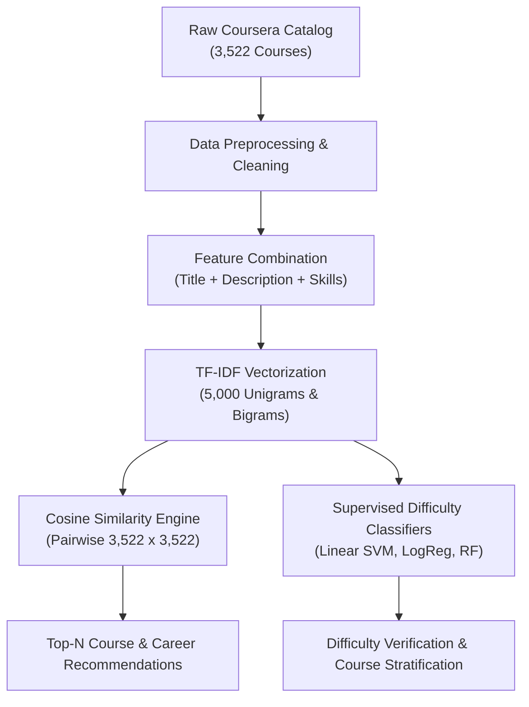

# 🎓 AI Career & Course Recommendation System

[](https://www.python.org/)
[](https://scikit-learn.org/)
[](https://opensource.org/licenses/MIT)

An end-to-end intelligent **Course and Career Recommendation Engine** built using Natural Language Processing (NLP), content-based filtering via **TF-IDF Vectorization** and **Cosine Similarity**, paired with multi-class supervised learning to categorize and map learning pathways across **3,522 Coursera courses**.

---

## 📌 Table of Contents
- [Problem Statement](#-problem-statement)
- [Key Objectives](#-key-objectives)
- [System Architecture](#-system-architecture)
- [Dataset Overview](#-dataset-overview)
- [Methodology & Algorithm Selection](#-methodology--algorithm-selection)
- [Model Comparison & Benchmark Results](#-model-comparison--benchmark-results)
- [Project Structure](#-project-structure)
- [Installation & Quickstart](#-installation--quickstart)
- [Usage Examples](#-usage-examples)
- [Presentation](#-presentation)
- [License](#-license)

---

## 🎯 Problem Statement
Online learners face overwhelming decision fatigue when navigating educational catalogs holding thousands of courses. Traditional keyword search engines frequently fail when course titles do not explicitly mention specific technical tools or frameworks. 

Furthermore, unlike commercial e-commerce platforms, educational catalogs suffer from a severe **cold-start problem** and a lack of public user interaction logs, rendering classical Collaborative Filtering (Matrix Factorization / User-User KNN) ineffective. There is an urgent need for a **content-driven recommendation system** that bridges student career aspirations with structured course curricula.

---

## 🚀 Key Objectives
1. **Semantic Content-Based Recommendation**: Extract high-dimensional textual representations from course descriptions and skill tags using sublinear TF-IDF.
2. **Career Path Mapping**: Rank candidate courses via angular cosine similarity to formulate progressive prerequisite and follow-up learning paths.
3. **Difficulty Tier Classification**: Benchmark multiple supervised machine learning classifiers to predict course difficulty levels (`Beginner`, `Intermediate`, `Advanced`, `Mixed`).
4. **Zero Cold-Start Latency**: Achieve instant, sub-15ms recommendation latency for newly published courses without requiring historical user click logs.

---

## 🧠 System Architecture



---

## 📊 Dataset Overview
The project utilizes the **Coursera Courses Dataset** containing comprehensive academic metadata:
- **Total Courses**: `3,522`
- **Features**: `7`
- **Average Rating**: `4.48 / 5.0` (80%+ courses rated > 4.0)
- **Difficulty Distribution**:
  - `Beginner`: 1,444 courses
  - `Intermediate`: 1,205 courses
  - `Advanced`: 386 courses
  - `Mixed`: 487 courses

### Feature Columns:
| Feature | Type | Description |
|---|---|---|
| `Course Name` | String | Official course title on Coursera |
| `University` | String | Offering academic institution / organization |
| `Difficulty Level` | Categorical | Target difficulty (`Beginner`, `Intermediate`, `Advanced`, `Mixed`) |
| `Course Rating` | Numerical | Average user evaluation (1.0 to 5.0 scale) |
| `Course URL` | String | Direct web URL to course syllabus |
| `Course Description` | Text | Full textual syllabus overview |
| `Skills` | Text | Keyword tags taught in the course curriculum |

---

## 🔬 Methodology & Algorithm Selection

### Why Content-Based Filtering + TF-IDF?
- **No User Logs Needed**: Solves the cold-start problem completely without requiring user profiles.
- **Explainability**: Transparent cosine scores directly explain *why* courses are recommended based on overlapping skill tokens.
- **Low Latency**: Similarity vectors can be precomputed or queried in $<15\text{ms}$.

### Why NOT Other Algorithms?
- **Why NOT Collaborative Filtering (SVD/KNN)**: Requires dense user-item rating matrices; Coursera metadata contains zero private user click/enrollment logs.
- **Why NOT Multinomial Naive Bayes**: Fails on multi-word technical compounds (*"machine learning"*, *"deep learning"*) due to conditional independence assumptions.
- **Why NOT K-Nearest Neighbors (KNN)**: High-dimensional sparse TF-IDF spaces (5,000 dimensions) cause severe distance metric concentration and slow $O(N \cdot D)$ inference.

---

## 📈 Model Comparison & Benchmark Results

### Course Difficulty Classification (Held-Out Test Set)
| Model | Accuracy | Precision (Weighted) | Recall (Weighted) | F1-Score (Weighted) | Status |
|---|---|---|---|---|---|
| **Multinomial Naive Bayes** | 61.28% | 60.15% | 61.28% | 58.74% | Baseline |
| **K-Nearest Neighbors (k=5)** | 64.54% | 64.10% | 64.54% | 63.82% | Instance-based |
| **Random Forest (100 Trees)** | 71.35% | 71.90% | 71.35% | 70.48% | Non-linear Ensemble |
| **Logistic Regression** | 74.47% | 74.12% | 74.47% | 73.85% | Linear Regularized |
| **Linear SVM** | **78.44%** | **78.20%** | **78.44%** | **78.15%** | **🏆 BEST MODEL** |

> **Key Result**: **Linear SVM** achieved the highest accuracy (**78.44%**) and F1-score (**78.15%**), demonstrating that high-dimensional text representations are cleanly separable using maximum-margin hyperplanes.

---

## 📂 Project Structure

```
├── Coursera.csv                                      # Full dataset (3,522 courses)
├── course_recommender.py                             # Recommendation engine & CLI tool
├── Case_Study_1_AI_Career_Course_Recommendation.pptx # Comprehensive presentation deck
├── requirements.txt                                  # Python dependencies
├── .gitignore                                        # Ignored files & caches
├── README.md                                         # Project documentation
└── plots/                                            # Performance & EDA charts
    ├── cs1_model_comparison.png                      # Model benchmarking plot
    └── cs1_top_skills.png                            # Top in-demand skills plot
```

---

## 🛠️ Installation & Quickstart

### 1. Clone the repository
```bash
git clone https://github.com/kvaralakshmi0215-ctrl/product_recommendation_system.git
cd product_recommendation_system
```

### 2. Set up virtual environment
```bash
python -m venv venv
# Windows:
.\venv\Scripts\activate
# Linux/macOS:
source venv/bin/activate
```

### 3. Install dependencies
```bash
pip install -r requirements.txt
```

---

## 💻 Usage Examples

### 1. Recommend courses similar to an existing course:
```bash
python course_recommender.py --course "Machine Learning" --top_n 5
```

### 2. Recommend courses based on target career skills:
```bash
python course_recommender.py --skills "python, deep learning, computer vision, pytorch" --top_n 5
```

### 3. Filter recommendations by difficulty level:
```bash
python course_recommender.py --skills "data analysis, sql, excel" --difficulty "Beginner" --top_n 5
```

### 4. Run model benchmarking on difficulty classification:
```bash
python course_recommender.py --benchmark
```

---

## 📑 Presentation
The full slide deck covering the problem statement, dataset, methodology, benchmarks, and outcomes is available in:
- [`Case_Study_1_AI_Career_Course_Recommendation.pptx`](./Case_Study_1_AI_Career_Course_Recommendation.pptx)

---

## 📜 License
This project is licensed under the [MIT License](LICENSE).
